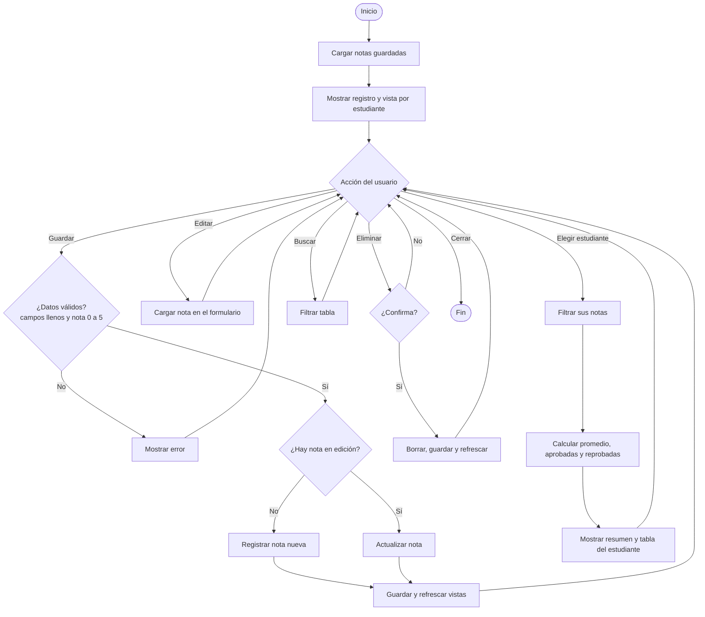

# Diseño: pseudocódigo y diagrama de flujo

## Modelo de datos
```
Nota = { id, estudiante, materia, curso, nota (0.0 a 5.0), fecha }
```
Se aprueba con nota >= 3.0.

## Pseudocódigo
```
INICIO
  notas ← LEER_ALMACENAMIENTO()          // lista vacía si no existe
  idEnEdicion ← NULO
  MOSTRAR_REGISTRO(notas); MOSTRAR_ESTUDIANTE(notas)

  MIENTRAS la aplicación esté abierta HACER
    ESPERAR evento del usuario

    SEGÚN evento
      CASO "Guardar nota":
        LEER estudiante, materia, curso, nota del formulario (recortar espacios)
        SI estudiante, materia o curso están vacíos ENTONCES
          MOSTRAR error junto al campo; CONTINUAR
        SI nota no es número O nota < 0 O nota > 5 ENTONCES
          MOSTRAR error "Escribe una nota entre 0,0 y 5,0"; CONTINUAR

        SI idEnEdicion = NULO ENTONCES                 // REGISTRAR
          AGREGAR {NUEVO_ID(), estudiante, materia, curso, nota, AHORA()} A notas
          MENSAJE "Nota guardada"
        SINO                                            // EDITAR
          ACTUALIZAR la nota con id = idEnEdicion
          MENSAJE "Cambios guardados"
        FIN SI
        GUARDAR_ALMACENAMIENTO(notas)
        LIMPIAR_FORMULARIO(); idEnEdicion ← NULO
        REFRESCAR_VISTAS()

      CASO "Editar" nota X:
        idEnEdicion ← X.id; CARGAR X en el formulario

      CASO "Eliminar" nota X:
        PREGUNTAR "¿Eliminar esta nota?"
        SI confirma ENTONCES
          QUITAR X DE notas
          SI idEnEdicion = X.id ENTONCES LIMPIAR_FORMULARIO()
          GUARDAR_ALMACENAMIENTO(notas); REFRESCAR_VISTAS()
          MENSAJE "Nota eliminada"

      CASO "Buscar" texto:
        MOSTRAR notas DONDE estudiante, materia o curso CONTENGA texto

      CASO "Elegir estudiante" E:                       // VISTA INDIVIDUAL
        lista ← notas DONDE estudiante = E, ORDENADAS por materia
        SI lista está vacía ENTONCES MOSTRAR "Elige un estudiante"
        SINO
          promedio ← SUMA(lista.nota) / CANTIDAD(lista)
          aprobadas ← CANTIDAD(lista DONDE nota >= 3.0)
          reprobadas ← CANTIDAD(lista) - aprobadas
          MOSTRAR promedio, total, aprobadas, reprobadas
          PARA CADA nota EN lista
            MOSTRAR materia, curso, nota, estado ("Aprobada" o "Reprobada"), fecha
    FIN SEGÚN
  FIN MIENTRAS
FIN
```

## Diagrama de flujo

